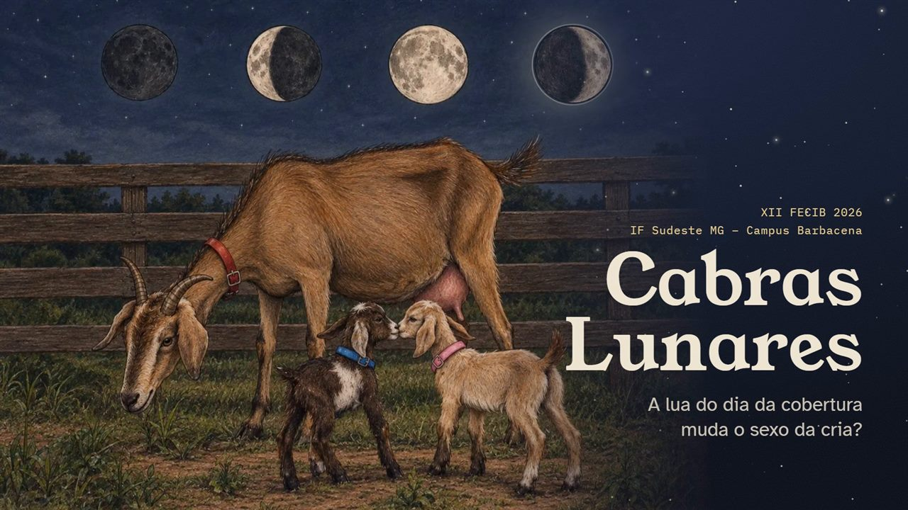
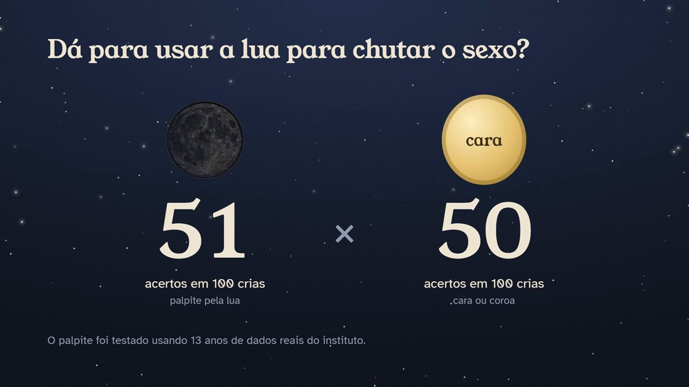
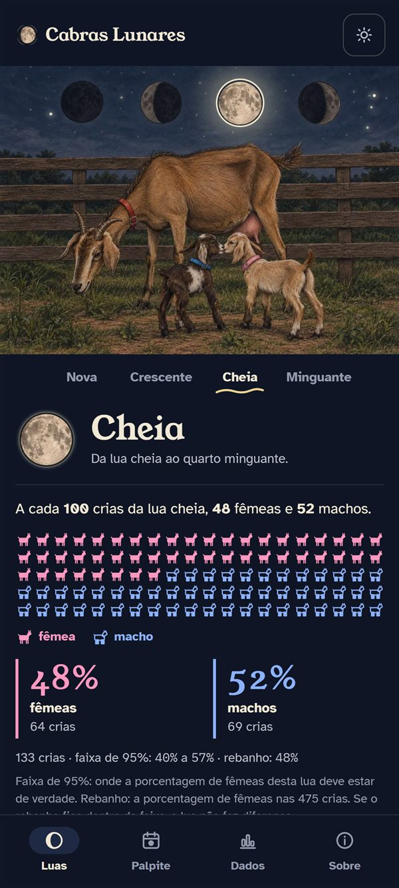
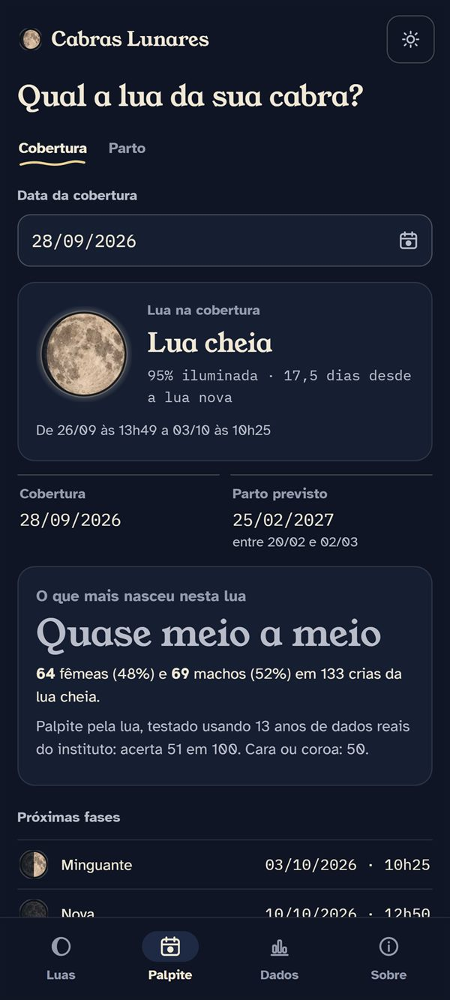
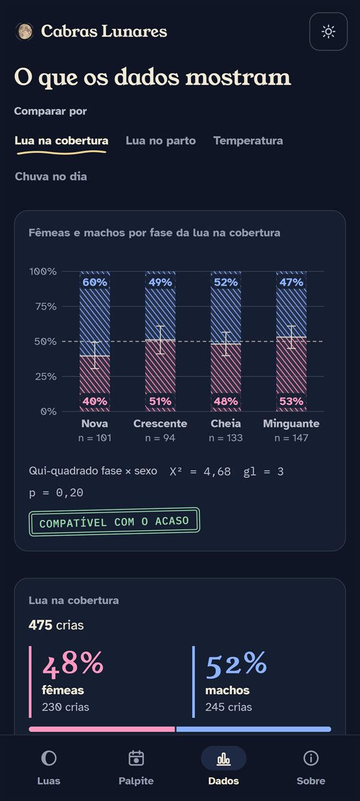

  

  <h1>Cabras Lunares</h1>

  

    <strong>App web e Android que investiga, com dados reais, se a fase da lua muda o sexo das crias de cabras.</strong>
  

  

    Projeto apresentado na XII FECIB, no IF Sudeste MG – Campus Barbacena, unindo ciência de dados, zootecnia e desenvolvimento web e mobile.
  

  

    
    
    
    
  

  <h3>▶️ <a href="https://cabras-lunares.netlify.app">Testar o app em cabras-lunares.netlify.app</a></h3>

  

## Sobre

Entre os criadores de cabras é comum ouvir que a fase da lua no dia da cobertura decide se vai nascer macho ou fêmea. O **Cabras Lunares** coloca essa ideia à prova com 13 anos de registros reais do rebanho Saanen do Núcleo de Zootecnia do IF Sudeste MG – Campus Barbacena.

O resultado virou um app em que o visitante escolhe uma data, descobre em que lua ela cai, dá o seu palpite e vê o que os dados do rebanho realmente mostram.

> Este é um repositório público de apresentação do projeto. O código-fonte completo, as planilhas do rebanho e os dados internos são mantidos em ambientes privados por segurança.

## Apresentação

**XII FECIB – Feira de Ciências do IF Sudeste MG – Campus Barbacena**
7 e 8 de outubro de 2026 · Categoria Investigativo

No estande, a apresentação rodava sozinha na TV, enquanto o público testava o app no computador, nos celulares e no tablet, dando palpites e conferindo a resposta dos dados.

## A Pergunta

**A fase da lua no dia da cobertura influencia o nascimento de machos ou fêmeas?**

Além da lua, o projeto também olha para a temperatura e a chuva, para separar o efeito de cada fator. Responder isso exige:

- reunir registros de nascimento e cobertura espalhados por várias planilhas e anos;
- conferir e corrigir dados incompletos ou inconsistentes, sem descartar nada em silêncio;
- calcular a fase da lua de cada data com precisão astronômica;
- aplicar um teste estatístico que diga se a diferença é real ou apenas acaso.

## O Que Foi Feito

Os registros do setor de caprinocultura foram auditados, mesclados e conferidos ano a ano até formar uma base única com **475 crias** com sexo conhecido. A fase da lua de cada cobertura foi calculada pelo algoritmo de Meeus (*Astronomical Algorithms*), no fuso de Brasília, e cruzada com o sexo de cada cria por meio do teste **qui-quadrado**.

Tudo isso foi transformado em uma experiência interativa: em vez de uma tabela de números, o visitante explora os dados por conta própria.

## O Resultado

**A lua não muda a proporção de fêmeas e machos.**

Nas 475 crias, as diferenças entre as fases da lua são compatíveis com o acaso (qui-quadrado X² = 4,68, gl = 3, p = 0,20). Testado nos 13 anos de dados reais, o palpite pela lua acerta **51 em cada 100 crias**, praticamente o mesmo que jogar cara ou coroa (**50 em 100**).

  

## Funcionalidades Apresentadas

- **Luas:** a proporção de fêmeas e machos nascidos em cada fase da lua, com a faixa de 95% de confiança.
- **Palpite:** escolha a data da cobertura ou do parto e veja a fase da lua, o parto previsto e o que mais nasceu naquela lua.
- **Dados:** gráficos por lua na cobertura, lua no parto, temperatura e chuva no dia, com o resultado do teste estatístico.
- **Ficha técnica:** a base, o método e os limites da análise.
- Modo dia e noite, cada um com a sua ilustração.
- Funciona sem internet, tanto no navegador quanto no Android.
- Apresentação para a TV do estande, que roda sozinha e também foi exportada em vídeo para TVs antigas.
- QR code impresso no estande para abrir o app no celular.

## Tecnologias

- **HTML, CSS e JavaScript** para o app web, em páginas únicas que funcionam até sem internet.
- **Flutter e Dart** para o app Android, com os mesmos números e textos do site.
- **Python** para auditoria, mesclagem e conferência dos dados e para o cálculo das fases da lua.
- **Netlify** para a publicação do app web.

## Interface

  
  
  

  <strong>Luas</strong>, <strong>Palpite</strong> e <strong>Dados</strong> no celular

## Impacto

O Cabras Lunares mostra como tecnologia e ciência de dados podem testar o conhecimento popular do campo, contribuindo para:

- substituir crença por evidência no manejo reprodutivo;
- valorizar os registros históricos do próprio rebanho do instituto;
- divulgar estatística de forma visual e acessível ao público;
- aproximar pesquisa, tecnologia e produção rural.

## Repositório

Este repositório existe para divulgar o projeto de forma pública. Ele não contém:

- código-fonte completo;
- planilhas e dados do rebanho;
- scripts de análise;
- chaves, credenciais ou configurações privadas.

## Equipe

- **Lucas Martin da Silva** – desenvolvimento, dados e software
- **Sabrina Patrícia Vidal** e **Thiago Augusto de Oliveira Campos** – dados
- **Prof. Dr. Robson Helen da Silva** – orientador
- **Prof. Marco de Moura Gromato** – coorientador

## Autor

**Lucas Martin**  
[GitHub](https://github.com/cuLasss) · [LinkedIn](https://www.linkedin.com/in/lucas-m4rtin/)

---

  Projeto desenvolvido com foco em ciência de dados, produção rural e divulgação científica.

